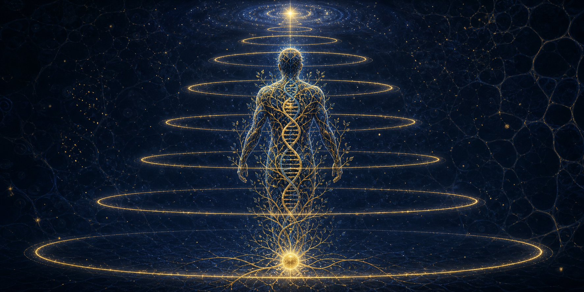

  

# The Adaptation Talent

**One law. Every holder. Every universe.** The complete doctrine of the account's
signature ability — the universal core, every character module, the craft rules,
and the full provenance — gathered into one clean, systematic home.

  
  
  

> **Universal core: Version 2.0, consolidated 30 July 2026 — universal, authoritative, locked.**
> Repository assembled 2026-10-13 from the working repositories, byte-preserving; nothing rewritten.

---

## What this is

The **Adaptation Talent** is an original ability system built for long-form fan fiction —
an innate, non-sentient principle that quietly optimizes its holder's entire existence
along the best path their real life actually supports. It is not a system cheat, not a
voice, not a second mind. It shows itself only through results.

The doctrine has lived where it was written: inside a dozen serial foundations, a codex,
status panels, and logs scattered across the account's repositories. **This repository is
its organized home** — the universal law in [`canon/`](canon/), one module per holder in
[`modules/`](modules/), the writing law in [`docs/`](docs/), the craft files that grew out
of it in [`practice/`](practice/), and a full copy-and-hash record in
[`provenance/`](provenance/).

## The law in one paragraph

> **Adaptation Talent is an innate, pure, inseparable, non-sentient existential principle
> present from conception that continuously uses the holder's real existence, experience,
> information, resources, intentions, recovery, relationships, and accessible reality to
> preserve, refine, integrate, personalize, and evolve the holder's complete being along
> the best presently supportable path compatible with identity, free will, deepest desires,
> chosen bonds, and actual conditions.**
> — Master Foundation v2.0, §2

**Technical classification:** Inseparable Recursive Whole-Existence Adaptive Evolution.
**Canonical name:** Adaptation Talent. **Divine-stage name:** Divine Adaptation Talent.
**Size of the law:** 76 sections across 7 Parts — see the map below.

## What it is — and what it is not

| It is | It is not |
|---|---|
| Present from conception; inseparable from the holder | A detachable organ, blessing, or foreign object |
| Non-sentient — no mind, no voice, no windows | An AI, a system screen, a narrator, a second soul |
| Always operating — maintaining, refining, waiting | Always escalating — raw output does not climb on its own |
| One law with many faces — every domain of a life | A universal power amplifier or a combat-only talent |
| Bounded by foundation, resources, and world law | A source of free power, instant mastery, or future knowledge |
| Refining and evolving *what exists* — and, through earned reach, constructing what becomes possible | A cheat that skips training, experience, or cost |

Each of those rows is a section of the law, not an editorial: see §3–§5, §6.3, §8,
§28, and §60 in [`canon/MASTER-FOUNDATION.md`](canon/MASTER-FOUNDATION.md).

## The map

| Path | What lives there |
|---|---|
| [`canon/`](canon/) | The universal law — **MASTER-FOUNDATION.md** (v2.0, 76 §§ / 4,853 lines), **LEVEL-FRAMEWORK.md** (the two-axis level and tier reference), **GENESIS-CODEX-ADAPTIVE.md**, **STORYOS-ADAPTATION-FIREWALL.md** |
| [`docs/`](docs/) | The guided read — [01 The Talent](docs/01_the_talent.md) · [02 How It Works](docs/02_how_it_works.md) · [03 Orders & Maturity](docs/03_orders_and_maturity.md) · [04 Writing It](docs/04_writing_it.md) · [05 The Holders](docs/05_the_holders.md) |
| [`QUICK-REFERENCE.md`](QUICK-REFERENCE.md) | The law on one page — definition, ladder, orders, the three documents, and the fifty never-forget rules (§75), for use mid-session |
| [`modules/`](modules/) | One file per holder — 17 holders across 5 worlds, each sitting beneath the universal core per §71/§76. Start at the [module index](modules/README.md) |
| [`templates/`](templates/) | Blank forms in the house shape — [module](templates/holder-module.md) (§71) · [status panel](templates/status-panel.md) (§69) · [log entry](templates/adaptation-log-entry.md) (§70) |
| [`tools/`](tools/) | [`check.py`](tools/check.py) — the repository verifies itself (every file against `MANIFEST.sha256`, every relative link resolved); CI runs it on every push |
| [`practice/`](practice/) | The StoryOS craft files forged from this work — the skills (working, universal, and the locked ultimate master), the AT toolkit, the firewall, the system index, the Naagin control book, the lessons ledger |
| [`provenance/`](provenance/) | [COPIES-AND-TWINS.md](provenance/COPIES-AND-TWINS.md) — where every file came from, its sha256, and the duplicates deliberately **not** propagated |
| [`assets/`](assets/) | The banner |

## The holders

Seventeen holders across five worlds — Soul Land's four eras and their spin-off lineages,
the MCU twice over (an Eternal and a Stark heir), Avengers, two Naagin projects (kept apart
by law), and Dragon Prince Yuan.
Full register with status and module links:
**[docs/05_the_holders.md](docs/05_the_holders.md)**.

| Holder | Universe | Module |
|---|---|---|
| Lan Shen | Soul Land 1 (Douluo Continent, pre-canon) | [lan-shen.md](modules/lan-shen.md) |
| The Sunweave Blue Silver Grass | Soul Land (blue_silver rebuild) | [blue-silver.md](modules/blue-silver.md) |
| The Devouring Dragon | Soul Land (beast-form serial) | [devouring-dragon.md](modules/devouring-dragon.md) |
| Luo Chen | Soul Land 1 (holy spirit branch) | [luo-chen-holy-spirit.md](modules/luo-chen-holy-spirit.md) |
| Qian Xun Ji | Soul Land 1 era (Qian Xunji serial) | [qian-xunji.md](modules/qian-xunji.md) |
| Fire Dragon Lizard OC | Soul Land 1 (fire dragon lizard serial) | [fire-dragon-lizard.md](modules/fire-dragon-lizard.md) |
| Jin Yang | Soul Land 2 (The Golden Lion) | [jin-yang-golden-lion.md](modules/jin-yang-golden-lion.md) |
| Su Yan | Soul Land 3 (One in a Thousand) | [su-yan-one-in-a-thousand.md](modules/su-yan-one-in-a-thousand.md) |
| The Silver-Golden Wolf | Soul Land 3 | [silver-golden-wolf.md](modules/silver-golden-wolf.md) |
| The Seed of Creation holder | Soul Land 2.5 | [seed-of-creation.md](modules/seed-of-creation.md) |
| Yan Shuo'er | Soul Land 4 (Fire Phoenix) | [yan-shuo-fire-phoenix.md](modules/yan-shuo-fire-phoenix.md) |
| Zhou Xu | Dragon Prince Yuan (元尊) | [zhou-xu-dragon-prince-yuan.md](modules/zhou-xu-dragon-prince-yuan.md) |
| Mark Howard Stark | MCU-adjacent (Stark Heir) | [mark-stark-heir-study.md](modules/mark-stark-heir-study.md) |
| The Eternal OC | MCU (Earth-199999) | [eternal-oc-mcu.md](modules/eternal-oc-mcu.md) |
| Evo | Avengers Assemble S1–S2 | [evo-avengers.md](modules/evo-avengers.md) |
| Sheshveer (Gaurav) | Naagin S1 (2015 canon, alternate) | [sheshveer-naagin-s1.md](modules/sheshveer-naagin-s1.md) |
| Vihaan Suri | Naagin 7 — The Shesh Naag (unawakened) | [vihaan-naagin7.md](modules/vihaan-naagin7.md) |

*(Evo, Sheshveer, and Vihaan Suri were assembled on 2026-10-13 from the craft layer — each
module quotes its sources verbatim and says so at the top. The two Naagin projects are
distinct on purpose; the register's §5 wall explains why.)*

## Reading paths

- **New to the Talent** → [docs/01 The Talent](docs/01_the_talent.md) → [docs/02 How It Works](docs/02_how_it_works.md) → [docs/03 Orders & Maturity](docs/03_orders_and_maturity.md).
- **Writing a chapter with it** → [docs/04 Writing It](docs/04_writing_it.md) → your holder's module → the holder's local log.
- **Creating a new holder** → §71's module template (described in docs/04) → copy the shape of any module here.
- **Checking a claim** → [provenance/COPIES-AND-TWINS.md](provenance/COPIES-AND-TWINS.md) for the hash, then the cited section of the master.

## Authority

When two files disagree, the law resolves in this order (Master §1, verbatim intent):

1. The author's latest explicit correction
2. The Advanced Definitive Master Foundation v2.0
3. The latest verified character- and universe-specific module
4. The latest verified current-state ledger
5. Earlier status panels and foundations
6. Assistant inference

**The author's own words are the top layer.** Modules quote their founding rulings
verbatim for exactly this reason.

## House rules

- **One copy law.** [`canon/MASTER-FOUNDATION.md`](canon/MASTER-FOUNDATION.md) is this
  repository's single universal copy. Duplicates found during assembly were not
  propagated; every one of them is recorded, with hashes, in
  [provenance/COPIES-AND-TWINS.md](provenance/COPIES-AND-TWINS.md).
- **Modules never rewrite the core.** Per §76, a story creates a module *beneath* the
  foundation. Nothing in `modules/` changes a universal rule.
- **Receipts in place.** Module files are preserved as written — including their original
  path references to the repositories and upload folders they were born in. Current
  canonical locations are mapped in [`modules/README.md`](modules/README.md) and
  `provenance/`.
- **Nothing is lost.** Superseded snapshots (earlier module versions, audit-before
  copies) are listed in provenance rather than scattered — the account's
  "one copy of one thing" discipline.

## The workshop

This repository is part of a working account — the Soul Land serials, the shelved public
library, and the method itself:

- [how-to-write-fanfiction](https://github.com/gm5206663-bit/how-to-write-fanfiction) — the production method these serials are built with
- [soul-land-universal-kit](https://github.com/gm5206663-bit/soul-land-universal-kit) — the workshop and the serials
- [the-authors-desk](https://github.com/gm5206663-bit/the-authors-desk) — the register of everything
- [stark_heir](https://github.com/gm5206663-bit/stark_heir) · [mcu_eternal_fanfic](https://github.com/gm5206663-bit/mcu_eternal_fanfic) — the two MCU serials

---

*Assembled 2026-10-13. The universal core has been locked since 30 July 2026; modules
accretion beneath it is the designed way this law grows. Future universal amendments
follow the seven-step protocol in §76.*
